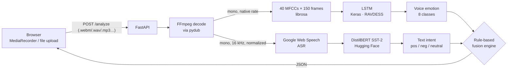

# EmoVoice AI — Multimodal Speech Emotion Recognition

EmoVoice AI listens to **what** you say and **how** you say it, then fuses both signals to catch emotions that text-only systems miss: sarcasm, quiet disappointment, hidden frustration.

> *"Great job."* said through gritted teeth → text says **positive**, voice says **angry** → **Sarcasm or Passive-Aggressive Tone Detected**

Built as a Deep Learning course project (BS Artificial Intelligence, Bahria University, H-11 Campus).

---

## Contents

- [How it works](#how-it-works)
- [Quick start](#quick-start)
- [Using the app](#using-the-app)
- [API reference](#api-reference)
- [Configuration](#configuration)
- [Fusion rules](#fusion-rules)
- [The acoustic model](#the-acoustic-model)
- [Training your own model](#training-your-own-model)
- [Testing](#testing)
- [Project structure](#project-structure)
- [Known limitations & roadmap](#known-limitations--roadmap)

---

## How it works



| Layer | Technology | Role |
|---|---|---|
| Frontend | HTML, Tailwind CSS, vanilla JS, MediaRecorder API | Push-to-talk recording, file upload, results display |
| API | FastAPI + Uvicorn | Validation, orchestration, temp-file lifecycle |
| Preprocessing | pydub + FFmpeg | Decode any browser codec into two WAV copies (one per path) |
| Linguistic path | Google Web Speech API → DistilBERT (SST-2) | Transcript → text sentiment |
| Acoustic path | librosa MFCCs → 2-layer LSTM | Tone of voice → 8 RAVDESS emotions |
| Decision | Rule-based fusion (`backend/fusion.py`) | Reconciles the two signals into one interpretation |

The two paths are **independent**: if no speech is recognized, or the ASR service is unreachable, you still get the voice emotion and a voice-only decision instead of an error.

---

## Quick start

### 1. Prerequisites

- **Python 3.10 – 3.13**
- **FFmpeg** on your `PATH`
  - Windows: `winget install Gyan.FFmpeg` (then open a new terminal)
  - macOS: `brew install ffmpeg`
  - Ubuntu/Debian: `sudo apt install ffmpeg`
  - Check with `ffmpeg -version`
- An internet connection (Google speech recognition, plus a one-time ~270 MB download of the DistilBERT model on first start)

### 2. Install

```bash
git clone https://github.com/mustafa007-1/EMOBOT-AI.git
cd EMOBOT-AI

python -m venv .venv
# Windows:      .venv\Scripts\activate
# macOS/Linux:  source .venv/bin/activate

# Optional but recommended: CPU-only PyTorch is a much smaller download
pip install torch --index-url https://download.pytorch.org/whl/cpu

pip install -r requirements.txt
```

### 3. Run the backend

From the **repository root**:

```bash
uvicorn backend.app:app --reload
```

Wait for `Application startup complete.` — the first launch takes longer while the sentiment model downloads. Check it's alive at <http://127.0.0.1:8000/health>; interactive API docs are at <http://127.0.0.1:8000/docs>.

### 4. Open the frontend

Either:

- **VS Code:** open `frontend/index.html` and click **Go Live** (Live Server extension, bottom-right), or
- **Any terminal:** `python -m http.server 5500 --directory frontend` and visit <http://127.0.0.1:5500>

Allow microphone access when the browser asks.

---

## Using the app

- **Live recording:** press and hold **HOLD TO RECORD**, speak, release.
- **Upload:** pick a `.wav`, `.mp3`, `.webm`, `.m4a`, `.ogg`, `.flac` or `.mp4` file (max 10 MB, 0.3 – 30 s).

The result card shows the transcript, text intent with confidence, voice emotion with confidence, the fused decision, and which modalities contributed.

Try these to see fusion at work:

| Say | Tone | Expected decision |
|---|---|---|
| "Perfect, just perfect." | Angry / hostile | Sarcasm or Passive-Aggressive Tone Detected |
| "That's really bad." | Calm, flat | Calm Negative / Disappointed Tone |
| "I'm fine." | Sad, shaky | Bittersweet / Melancholic Positivity |
| "This is amazing!" | Happy | Genuine Positive Emotion |

If the backend runs somewhere other than `127.0.0.1:8000`, open the page as `index.html?api=http://host:port`.

---

## API reference

### `POST /analyze`

Multipart form upload with one field, `file`.

```bash
curl -X POST http://127.0.0.1:8000/analyze -F "file=@sample.wav"
```

**200 OK**

```json
{
  "transcript": "great job",
  "text_intent": { "label": "POSITIVE", "confidence": 1.0, "raw_label": "POSITIVE" },
  "voice_emotion": {
    "label": "angry",
    "confidence": 0.81,
    "probabilities": { "neutral": 0.01, "calm": 0.03, "happy": 0.02, "sad": 0.04,
                       "angry": 0.81, "fearful": 0.05, "disgust": 0.03, "surprised": 0.01 }
  },
  "fusion_decision": "Sarcasm or Passive-Aggressive Tone Detected",
  "fusion_mode": "multimodal",
  "asr_status": "ok",
  "duration_seconds": 2.4,
  "processing_ms": 1640
}
```

| Field | Values |
|---|---|
| `text_intent.label` | `POSITIVE`, `NEGATIVE`, `NEUTRAL` (low-confidence polarity), or `N/A` (no speech) |
| `text_intent.raw_label` | The sentiment model's original output before the neutral threshold |
| `fusion_mode` | `multimodal` · `text_only` (voice confidence too low) · `voice_only` (no speech recognized) · `none` |
| `asr_status` | `ok` · `no_speech` · `unavailable` (speech service unreachable) |

**Errors** return `{"detail": "<human-readable message>"}`:

| Status | When |
|---|---|
| 413 | File larger than the upload limit |
| 415 | Unsupported file extension |
| 422 | Empty, undecodable, too short or too long audio |
| 500 | Unexpected server error (details in the server log) |

### `GET /health`

`{"status": "ok", "models_loaded": true}`

---

## Configuration

Every setting has a sensible default and can be overridden with an environment variable:

| Variable | Default | Purpose |
|---|---|---|
| `EMOVOICE_MODEL_PATH` | `models/ser_lstm_model.keras` | Acoustic model file |
| `EMOVOICE_SENTIMENT_MODEL` | `distilbert/distilbert-base-uncased-finetuned-sst-2-english` | Hugging Face text model |
| `EMOVOICE_VOICE_THRESHOLD` | `0.40` | Minimum voice confidence used by fusion |
| `EMOVOICE_TEXT_NEUTRAL_THRESHOLD` | `0.70` | Text confidence below this counts as neutral |
| `EMOVOICE_MAX_UPLOAD_MB` | `10` | Upload size limit |
| `EMOVOICE_MIN_AUDIO_SECONDS` / `EMOVOICE_MAX_AUDIO_SECONDS` | `0.3` / `30` | Accepted clip length |
| `EMOVOICE_ASR_LANGUAGE` | `en-US` | Speech recognition language |
| `EMOVOICE_ASR_TIMEOUT` | `10` | Seconds before the ASR call gives up |
| `EMOVOICE_ALLOWED_ORIGINS` | `*` | Comma-separated CORS origins |
| `EMOVOICE_HOST` / `EMOVOICE_PORT` | `127.0.0.1` / `8000` | Bind address when run with `python backend/app.py` |

Example (PowerShell): `$env:EMOVOICE_VOICE_THRESHOLD="0.5"; uvicorn backend.app:app`

---

## Fusion rules

Voice predictions count only when their confidence is at least `EMOVOICE_VOICE_THRESHOLD`; otherwise the decision falls back to text alone.

| Text intent ↓ / Voice → | angry, disgust | fearful | sad | calm, neutral | happy, surprised / unreliable |
|---|---|---|---|---|---|
| **Positive** | Sarcasm or Passive-Aggressive Tone | Sarcasm or Passive-Aggressive Tone | Bittersweet / Melancholic Positivity | Calm Positive / Content | Genuine Positive Emotion |
| **Negative** | High Hostility • Anger Detected | Deep Emotional Distress | Deep Emotional Distress | Calm Negative / Disappointed Tone | Negative Intent |
| **Neutral** | Hidden Anger / Frustration | Underlying Sadness or Anxiety | Underlying Sadness or Anxiety | Neutral Emotional State | Subtle Positive Emotion *(happy/surprised)* · Neutral Emotional State *(unreliable)* |
| **No speech** | `Voice-only: <Emotion> tone (speech not transcribed)` if voice is reliable, else *Insufficient data for fusion analysis.* | | | | |

---

## The acoustic model

| | |
|---|---|
| Dataset | [RAVDESS](https://zenodo.org/records/1188976) speech subset — 24 actors, 1,440 clips, 8 emotions |
| Features | 40 MFCCs per frame, 150 frames (≈3.5 s at 22.05 kHz), zero-padded/truncated |
| Architecture | `Input(150,40) → LSTM(128, seq) → Dropout(0.3) → LSTM(64) → Dropout(0.3) → Dense(64, relu) → Dense(8, softmax)` |
| Training | Adam, sparse categorical cross-entropy, batch 32, up to 50 epochs, balanced class weights |
| Reported result | **92.88 %** test accuracy (stratified random 80/20 split of clips) |

Clips longer than 3.5 s are scored with 50 %-overlapping windows whose probabilities are averaged, so the model hears the whole utterance.

**About that number.** A random split puts different clips from the *same actors* in both train and test sets, so 92.88 % measures recognition of voices the model has already heard. For a stricter, speaker-independent figure, retrain with `--split actor` (below) and report both.

---

## Training your own model

1. Download RAVDESS from [Kaggle](https://www.kaggle.com/datasets/uwrfkaggler/ravdess-emotional-speech-audio) and extract it into `data/RAVDEES DATASET/`. Any nesting works; duplicate copies of the same clip are detected and skipped automatically.
2. Train:

```bash
# Same protocol as the reported result (stratified random split)
python train_model.py

# Speaker-independent evaluation: test actors never seen in training
python train_model.py --split actor

# All options
python train_model.py --help
```

The script holds out a test set, carves a validation set from the remaining data for early stopping and checkpointing (the test set is never used for training decisions), and writes:

- `models/ser_lstm_model.keras` — best epoch by validation loss
- `models/ser_lstm_model.metrics.json` — test accuracy, per-class precision/recall/F1, confusion matrix, run config
- `models/ser_lstm_model.history.csv` — per-epoch loss and accuracy (handy for plots)

Runs are reproducible: `--seed` (default 42) seeds Python, NumPy and TensorFlow.

Feature extraction lives in `backend/features.py` and is shared by training and the API, so the model always sees identically computed features.

---

## Testing

```bash
pip install -r requirements-dev.txt
pytest
```

The suite covers every fusion rule, feature parity with the original training code, the API's success and failure paths (using fake models — no internet needed), and a smoke test against the real `.keras` model. FFmpeg is required.

---

## Project structure

```
EMOBOT-AI/
├── backend/
│   ├── app.py          # FastAPI app: validation, preprocessing, inference, response
│   ├── features.py     # MFCC extraction shared by training and serving
│   └── fusion.py       # Rule-based fusion engine (pure functions)
├── frontend/
│   └── index.html      # Single-page UI
├── models/
│   └── ser_lstm_model.keras
├── data/
│   └── RAVDEES DATASET/  # put the dataset here (not committed)
├── tests/              # pytest suite
├── train_model.py      # training script (CLI)
├── requirements.txt
└── requirements-dev.txt
```

---

## Known limitations & roadmap

**Limitations**

- English only (ASR language, SST-2 sentiment model, RAVDESS actors).
- Speech recognition uses Google's free web API: needs internet, sends audio to Google, and is rate-limited — fine for a demo, not for production.
- RAVDESS is acted, studio-quality speech; real microphones, accents and background noise lower acoustic accuracy.
- Fusion is hand-written rules, not learned.

**Roadmap**

- Local Whisper ASR for privacy and offline use
- Learned (neural) fusion over text embeddings and acoustic features
- Docker image and cloud deployment

---

## Acknowledgements

- Livingstone, S. R., & Russo, F. A. (2018). *The Ryerson Audio-Visual Database of Emotional Speech and Song (RAVDESS).* PLoS ONE 13(5): e0196391. Dataset licensed CC BY-NC-SA 4.0.
- Sentiment model: `distilbert-base-uncased-finetuned-sst-2-english` by Hugging Face.

**Author:** Mustafa Waheed — Deep Learning, BS AI, Bahria University (H-11 Campus).
